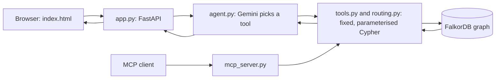

# MetroMarg (मेट्रो मार्ग): getting to Jantar Mantar when the metro stations are shut

**Graph Hacks submission. Track entered: Track 1, Agents That Act on Connected Data.**

Team: Nilesh Thipe (solo entry) · [Demo video](https://youtu.be/gkXa_tMcAOI) (best in 1080p) · [Live demo](https://metromarg-graphhacks-2026.onrender.com/) · [Source code](https://github.com/nilesh0199/MetroMarg-GraphHacks-2026)

MetroMarg is an agent that answers one question from a graph of the Delhi Metro: **how did the entry and exit closure at 45 stations on 9 to 10 October 2026 change the way to Jantar Mantar?**

It reports what DMRC announced and what the timetable data implies. It takes no position on the event itself.

**Data acknowledgment:** timetable data is the DMRC static GTFS feed from [Delhi Open Transit Data](https://otd.delhi.gov.in/data/staticDMRC/), a platform of the Department of Transport, GNCTD, with IIIT-Delhi (version last updated 10 August 2023). This project is not endorsed by DMRC or the Department of Transport. See `DATA_SOURCE.md`.

## Try the live demo

Open https://metromarg-graphhacks-2026.onrender.com/ and click one of the example questions.

**Please allow up to a minute, sometimes longer, for an answer.** The answers are written by an AI language model (Gemini), and its replies can be slow, especially when it is busy. The site also runs on a free hosting plan that sleeps when idle, so the first visit can take about a minute to wake up. The time each graph tool took is shown under "What the agent called" on every answer. If the language model is unavailable, the page shows a clearly labelled saved answer for the example questions.

## Why I built this

Jantar Mantar is a long-standing site for public demonstrations in Delhi, and people travel there from many parts of the country. When DMRC closed entry and exit at stations around it on 9 to 10 October 2026, I wanted to know how a traveller would actually reach it. Closures like this can happen again, and the same question applies to any commuter, visitor or journalist. MetroMarg tries to answer it from the network itself and shows its working. It reports what DMRC and Delhi Police said and takes no position on the event.

## What it does

Ask a plain-English question. The agent picks one of five fixed graph tools, fills in its arguments, and writes a short answer. The page also shows the route, the tools that were called, and the exact Cypher that ran.

| Question | Tool | What the graph contributes |
| --- | --- | --- |
| How do I get to Jantar Mantar from Chandni Chowk? | `plan_trip_to_place` | Metro route plus walk, normally vs during the closure |
| Which stations near Jantar Mantar are open? | `access_to_place` | `NEAR` links joined to the closure record |
| How do I get from A to B? | `find_route` | Fastest ride that obeys the closure's transfer rule |
| Which stations are within 4 hops of Patel Chowk? | `station_impact` | Multi-hop traversal, with closed stations marked |
| Which are the most connected stations, and were they closed? | `most_connected_stations` | FalkorDB's built-in PageRank |

Every answer is one of four shapes: answered with a path, answered by an algorithm, not in the graph (the agent says so rather than guessing), or unknown station (no query runs).

### What the graph showed

Figures below come from the 2023 timetable data and estimated walking times, so treat the minutes as estimates.

- All of the 12 stations nearest to Jantar Mantar were among those with entry and exit closed. The nearest open station was about 3.5 km away (Chandni Chowk), against Janpath at about 240 m normally.
- 6 of the 10 most connected stations in the data (by PageRank) were among the 45 reported closed.
- Trains kept running through closed stations, so many trips were unaffected: a journey that only passed through closed stations, and changed trains where DMRC kept interchange open, took the same time.

## Why it needs a graph

If FalkorDB is removed, none of these answers can be produced. The product runs on:

- **Variable-length path queries** for routes and hop-distance, with a transfer rule written in Cypher.
- **A closure record in the graph** (`Closure` and `CLOSES` edges) that routing, nearest-open-station search and the info panel all read from.
- **A built-in graph algorithm** (PageRank) exposed as an agent tool.
- **Geographic search in Cypher** (`distance(point(...), point(...))`) to find the nearest open station.

## Graph data model

```
(:Station {stop_id, name, lat, lon, alias?})-[:NEXT {line, minutes}]->(:Station)
(:Place   {name, lat, lon})-[:NEAR {walk_min, meters}]->(:Station)
(:Closure {id, date, description, reason, sources, reported_count, matched_count})
        -[:CLOSES {interchange_open}]->(:Station)
```

- `NEXT` links neighbouring stations on a line, in both directions, with the median ride time from the timetable.
- `NEAR` links a place to stations within 8 km (up to 40), with an estimated walking time.
- `CLOSES` means entry and exit were closed. `interchange_open` records whether passengers could still change trains there.

## How it works



Design decisions:

1. **The model never writes Cypher.** It chooses a tool and fills arguments. Every query is written by a person and parameterised.
2. **Station names are checked against the graph first** (`resolve_station`), including aliases such as Seva Teerth (the new name of Udyog Bhawan). An unknown name stops the query.
3. **The answer sentence is checked** before it is shown: it may not name a station that the tools did not return. If a tool was not called, the agent refuses.
4. **The path is returned with the answer** (`nodes(path)`), not reconstructed afterwards.
5. **Saved answers are labelled.** If the language model is unavailable, the page may show an earlier saved answer for the same question, with a notice saying so. Saved answers for the example questions ship with the repository (`answer_cache.json`).

## The Cypher and algorithms the product depends on

| File | Query purpose |
| --- | --- |
| `import_gtfs.py` | Bulk load of stations and `NEXT` edges (`UNWIND`), `NEAR` links, the `Closure` record and `CLOSES` edges |
| `tools.py` `resolve_station` | Exact, case-insensitive, alias and unique partial name match |
| `tools.py` `impact` | `MATCH path = (s)-[:NEXT*1..N]->(t {name})`, shortest route per station |
| `tools.py` `place_access` | `Place-[:NEAR]->Station` with `OPTIONAL MATCH` on the closure |
| `tools.py` `critical_stations` | `CALL algo.pageRank('Station', 'NEXT')` |
| `routing.py` `_best_route` | Variable-length path, minutes summed with `reduce`, and a transfer rule: `all(i IN range(...) WHERE NOT (nodes(path)[i+1].name IN $no_transfer) OR relationships(path)[i].line = relationships(path)[i+1].line)` |
| `routing.py` `nearest_open_stations` | `distance(point(...), point(...))` to rank open stations by distance |
| `app.py` `current_event` | Reads the closure record for the info panel |

## Closure rules used

From DMRC's update of 9 October 2026 as reported in the press: entry and exit closed at 45 stations from 9 pm on 9 October (6 pm on 10 October given as the end time). Passengers could still change trains at the affected stations except New Delhi. The model therefore treats a closed station as one you cannot board or leave at, which trains still run through, and where you may change lines unless it is New Delhi.

## Data and sources

- **Network:** DMRC static GTFS timetable from Delhi Open Transit Data, https://otd.delhi.gov.in/data/staticDMRC/ (version last updated 10 August 2023). The portal asks for your intended use before a download, and its site is sometimes unavailable, so the unmodified file is included here as `dmrc_gtfs.zip`, with attribution, as the portal's terms allow for accurate reproduction with the source acknowledged. See `DATA_SOURCE.md`.
- **Closure event:** [Business Today](https://www.businesstoday.in/india/story/dmrc-issues-revised-metro-closure-update-ahead-of-oct-10-check-affected-stations-560777-2026-10-09) (DMRC's revised update) and [News On AIR](https://newsonair.gov.in/delhi-police-proposes-closure-of-entry-and-exit-gates-at-57-metro-stations-from-9-pm/) (the Delhi Police proposal for 57 stations).
- **Jantar Mantar location:** approximate coordinates, set in `import_gtfs.py`.
- All data is public. No personal or restricted data is used.
- **Design patterns:** the fixed tool catalogue, name resolution against the graph, the answer check and returning the path with each answer follow the approach described in WeMakeDevs' article [How to Build an Agent That Reasons Over a Graph](https://www.wemakedevs.org/blogs/how-to-build-an-agent-that-reasons-over-a-graph). The domain, graph model, closure rules and code here are this project's own.

## Limitations

- Answers can take up to a minute or more, because the AI language model can be slow or busy (see "Try the live demo").
- The timetable is from 2023. Two of the 45 reported stations (Yamuna Vihar, Khajuri Khas) are not in it, so 43 of 45 are modelled.
- Walking times are estimates from straight-line distance (× 1.3, at 4.5 km/h). Buses, taxis and other road transport are not modelled, so long walking times are not real recommendations.
- Ride times have no waiting time or interchange walking time.
- Route search is limited to 8 stops.
- Reports differ on the exact hours of the closure, and a station's status is modelled as closed for the whole event.
- The agent is advisory: it recommends where to get off and does not take actions outside the graph.

## Setup

Requirements: Docker, Python 3.12 or newer, a Gemini API key.

```
docker run -d --name falkordb -p 6379:6379 -p 3000:3000 -v falkordb_data:/data falkordb/falkordb:latest
pip install -r requirements.txt
```

The repository includes the unmodified timetable as `dmrc_gtfs.zip`, so you do not need the portal. Load the graph and start the app:

```
python import_gtfs.py dmrc_gtfs.zip
set GEMINI_API_KEY=your_key        (Windows; use export on macOS and Linux)
python app.py
```

Open http://localhost:8000. FalkorDB Browser is at http://localhost:3000 (graph name: `transport`). If the database restarts empty, `app.py` rebuilds the graph from `dmrc_gtfs.zip` on start.

### Configuration

By default the app connects to FalkorDB on `localhost:6379`. To use another instance, such as FalkorDB Cloud, set `FALKORDB_HOST` and `FALKORDB_PORT`, and if needed `FALKORDB_USERNAME`, `FALKORDB_PASSWORD` and `FALKORDB_SSL=1`, before running `import_gtfs.py` and `app.py`. When hosting, also set `HOST=0.0.0.0` and `PORT`, and keep `GEMINI_API_KEY` as a secret on the host, never in the code.

### Deployment

The live demo runs on Render as a Python web service (start command `python app.py`), with the graph hosted on FalkorDB Cloud (Free plan). All settings are environment variables, and no keys or passwords are stored in this repository.

### MCP server

`mcp_server.py` exposes the same five tools over MCP. Test it with `npx @modelcontextprotocol/inspector python mcp_server.py`, or add it to an MCP client:

```
{"mcpServers": {"metromarg": {"command": "python", "args": ["/path/to/mcp_server.py"]}}}
```

### Terminal version

`python cli.py` runs the same agent in the terminal (needs `pip install rich`).

## Disclosure of AI use

AI tools were used in this project, and I want to be clear about how.

- **Tools:** Google Antigravity as my coding environment, and Claude (Anthropic) as a guide throughout. Claude drafted most of the code in conversation with me, following the design approach in the hackathon's article.
- **What came from me:** the problem and the idea (how closures affect getting to Jantar Mantar). I picked the domain from my own shortlist (a college campus, public transport, or FalkorDB itself) after Claude suggested public transport as the most manageable. I chose the October 2026 closure as the event to model. I required the project to stay neutral and attribute everything to DMRC and Delhi Police, including the "why were the stations closed" panel. I chose the project name and decided to include the timetable file because the portal is often unavailable.
- **What I did:** set up Docker and FalkorDB, built the graph from the timetable, ran and tested the answers (including the cases where it correctly says a station is not in the graph), and checked the sources.

I can explain the graph model, the queries and the architecture.

## Files

`import_gtfs.py` builds the graph · `tools.py`, `routing.py` hold the Cypher tools · `agent.py` is the model loop and answer check · `app.py` and `index.html` are the web app · `mcp_server.py` is the MCP wrapper · `cli.py` is the terminal version · `inspect_gtfs.py` prints the structure of the timetable zip · `dmrc_gtfs.zip` and `DATA_SOURCE.md` hold the data and its attribution · `answer_cache.json` holds the saved answers.
